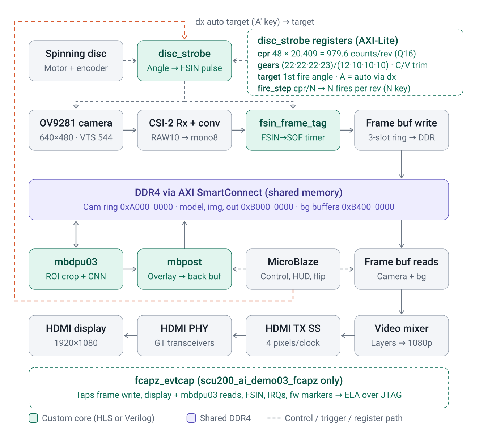
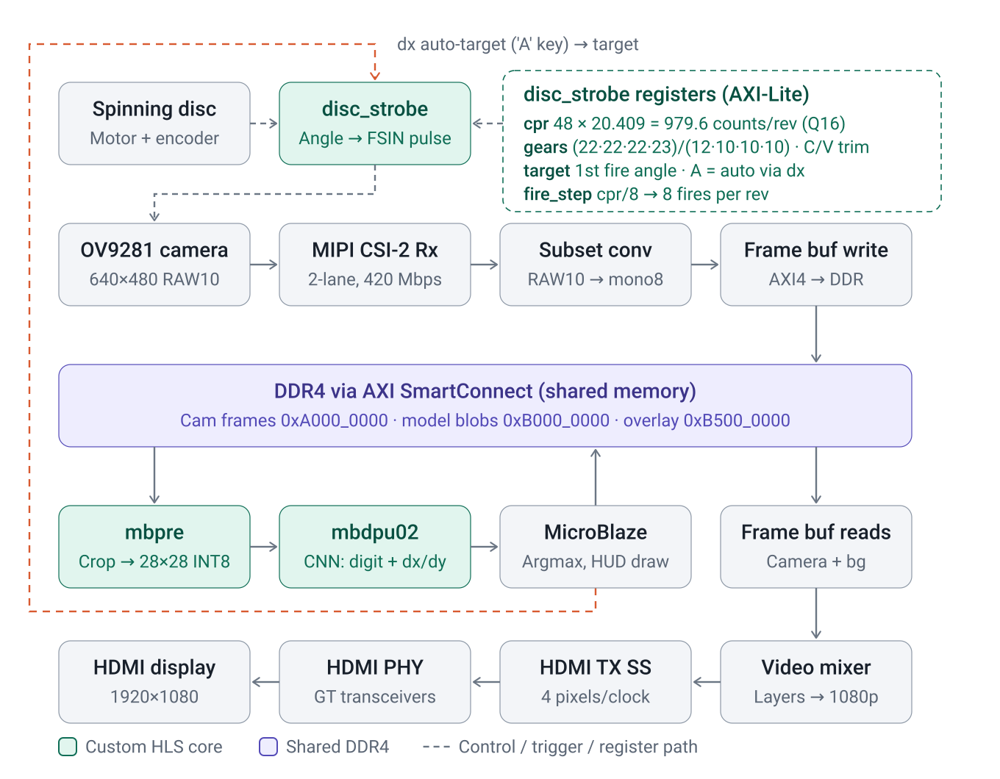
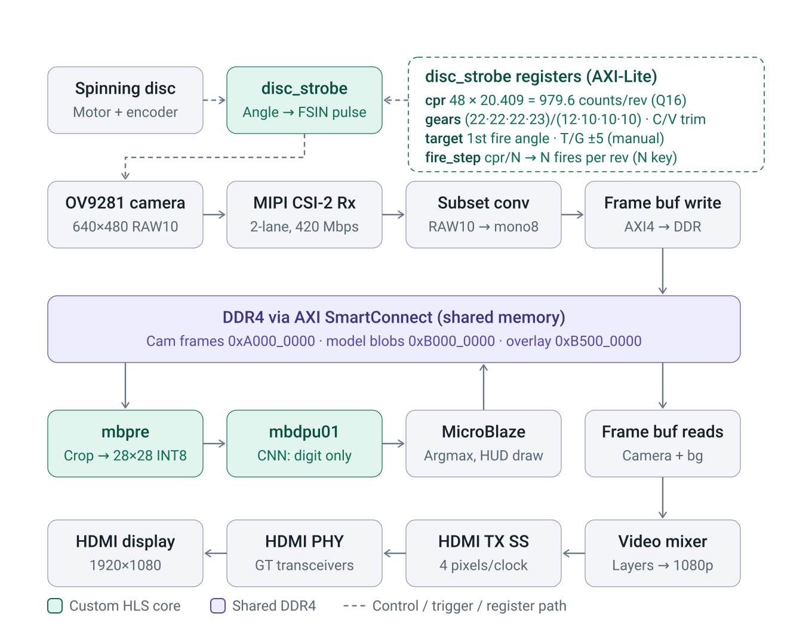

# Design diagrams: data path per demo

Each demo has its own branch: `scu200_ai_demo01`, `scu200_ai_demo02` and `scu200_ai_demo03`. Each builds on the one before.

| Demo | What it adds |
|---|---|
| demo01 | Angle-triggered capture; `mbpre` crop → `mbdpu01` CNN (digit only); MicroBlaze overlay |
| demo02 | `mbdpu02`, which adds a dx/dy position head; the dx auto-target loop |
| demo03 | `mbdpu03` (fused crop + 112×112 CNN, `mbpre` removed); `mbpost` HLS overlay; OV9281 snapshot trigger, one frame per strobe (`fsin_frame_tag` drop now off); fcapz variant |

Inside the AI cores (mbdpu01/02 with mbpre, mbdpu03, mbpost: block diagrams, cycle budgets, resources): [`scu200_ai_cores.html`](scu200_ai_cores.html), online at https://claude.ai/artifact/2PAhRSojcVdeYKw1ceHyfm (private until shared).

## scu200_ai_demo03

<picture>
  <source media="(prefers-color-scheme: dark)" srcset="scu200_ai_demo03_data_path_dark.svg">
  
</picture>

Profiling for this design: [`../profiling/demo03_profiling.md`](../profiling/demo03_profiling.md).

## scu200_ai_demo02

<picture>
  <source media="(prefers-color-scheme: dark)" srcset="scu200_ai_demo02_data_path_dark.svg">
  
</picture>

## scu200_ai_demo01

<picture>
  <source media="(prefers-color-scheme: dark)" srcset="scu200_ai_demo01_data_path_dark.svg">
  
</picture>

## Files

| File | What it is |
|---|---|
| `scu200_ai_demo0N_data_path.html` | **Source of truth.** The full page: diagram, legend and notes. Self-contained (Google Fonts optional), light/dark aware. |
| `scu200_ai_demo0N_data_path_light.svg` / `_dark.svg` | The standalone diagram with literal colours. Renders on GitHub and in Inkscape and rsvg. |
| `make_svgs.py` | Regenerates the SVGs from the HTML pages. Size, title and legend are taken from each page. |

An online version of the demo02 page is at https://claude.ai/artifact/2gZNdj2mzECtt8R8E92p5X (private until shared).

## Editing

The diagrams are hand-placed SVG, not generated from the block design:
- a 680-wide grid;
- 130×56 blocks at x = 40 / 190 / 340 / 490;
- rows at y = 56 / 152 / 248 (DDR) / 344 / 436.

To change one:
1. Edit the `<svg class="dp">` block in its HTML page.
2. Regenerate the SVGs:

```sh
python3 docs/diagrams/make_svgs.py docs/diagrams/scu200_ai_demo0{1,2,3}_data_path.html docs/diagrams/
```

## Traced from

- **Block designs:** `Vivado/src/bd/bd_scu200_ai_demo0N.tcl`. demo03 also uses `fcapz_evtcap_bd.tcl`.
- **Firmware:** `Vitis/common/src/main.c`, `frmbuf.c`, `disc_strobe.{h,c}`, `mbdpu01.{h,c}`.
- **HLS cores:** `Vivado/ip/{disc_strobe,mbpre,mbdpu01,mbdpu02,mbdpu03,mbpost}`.
- **Verilog:** `Vivado/src/hdl/fsin_frame_tag.v`.

**Common to all three:**
- **Capture:**
  - OV9281 (640×480 RAW10, 2-lane CSI-2 at 420 Mbps) → `mipi_csi2_rx_subsystem`.
  - → `axis_subset_converter` (`tdata[9:2]` replicated, R=G=B).
  - → `v_frmbuf_wr` → DDR `0xA0000000` (3-slot ring).
- **Trigger:** encoder A/B (`MOTOR_GPIO_I[1:2]`) → `disc_strobe` → `MOTOR_XVS` → OV9281 FSIN.
- **Display:**
  - The camera `v_frmbuf_rd` feeds `v_mix` layer 1 at (160, 500).
  - `bg_frmbuf_rd` feeds the `v_mix` master layer. It is page-flipped between `0xB5…` and `0xB6…`, with a pristine copy at `0xB4…`.
  - → `v_hdmi_txss1` (4 ppc) → `v_hdmi_phy1`.
- **Clocks:** 300 MHz for video and DDR; 100 MHz for `disc_strobe` and the AI cores.
